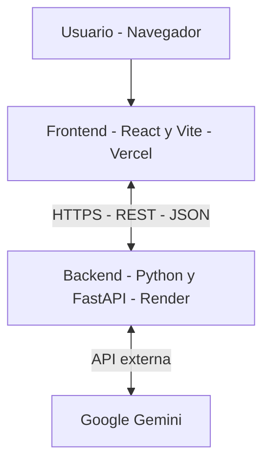

[English](README.md) | **Español**

# 🍕 Fornaviva

## Descripción del proyecto

Fornaviva es una aplicación web full-stack que simula la plataforma digital de una pizzería italiana ficticia.

La aplicación permite consultar la carta de pizzas, los horarios del establecimiento, la información sobre alérgenos y las preguntas frecuentes. Además, incorpora un asistente conversacional basado en inteligencia artificial, capaz de responder consultas y gestionar reservas simuladas.

El proyecto combina un frontend desarrollado con React y Vite, una API REST construida con Python y FastAPI, y la integración de inteligencia artificial mediante Google Gemini.

**Estado:** proyecto finalizado, desplegado y publicado.

**Versión oficial:** `v1.0.0`.

## Objetivo del proyecto

Fornaviva nace como un proyecto personal de aprendizaje y portfolio profesional, cuyo objetivo es aplicar conocimientos de desarrollo de software mediante la construcción de una aplicación web completa.

Su desarrollo abarca diferentes etapas del ciclo de vida del software: diseño, implementación, integración de servicios externos, pruebas automatizadas, accesibilidad, seguridad, rendimiento, documentación y despliegue.

## Demostración en línea

- **Aplicación web:** https://fornaviva.vercel.app
- **API REST:** https://fornaviva-api.onrender.com

La aplicación web es de acceso público y no requiere registro, instalación ni configuración de credenciales. Para utilizar el asistente con Google Gemini, basta con acceder a la demostración en línea. La integración está configurada en el backend de Render y está sujeta a la disponibilidad del servicio y a sus límites de uso.

La interfaz web y el asistente están disponibles en español.

Fornaviva es un proyecto demostrativo. El establecimiento es ficticio y las reservas no tienen validez comercial.

## Tecnologías utilizadas

| Tecnología | Responsabilidad |
|---|---|
| React | Desarrollo de la interfaz de usuario |
| Vite | Entorno de desarrollo y compilación del frontend |
| Python | Lenguaje de programación del backend |
| FastAPI | Desarrollo de la API REST |
| Pydantic | Validación de datos |
| Google Gemini | Inteligencia artificial conversacional |
| Pytest | Pruebas automatizadas del backend |
| Vitest | Pruebas automatizadas del frontend |
| Oxlint | Análisis estático del frontend |
| Vercel | Alojamiento y despliegue del frontend |
| Render | Alojamiento y despliegue del backend |
| Git y GitHub | Control de versiones y gestión del repositorio |

## Arquitectura del sistema

Fornaviva utiliza una arquitectura cliente-servidor con separación entre frontend y backend.

El frontend se comunica con el backend mediante peticiones HTTP a una API REST, utilizando JSON como formato de intercambio de datos.

El backend centraliza la lógica de la aplicación, la validación de datos y la comunicación con Google Gemini.

La integración con el servicio de inteligencia artificial se realiza exclusivamente desde el servidor, manteniendo las credenciales fuera del cliente.



## Estructura del proyecto

```text
Fornaviva/
├── backend/
│   ├── chatbot/
│   ├── data/
│   ├── routes/
│   ├── tests/
│   ├── main.py
│   ├── request_limits.py
│   └── requirements.txt
├── frontend/
│   ├── src/
│   │   ├── data/
│   │   ├── App.jsx
│   │   ├── ChatWidget.jsx
│   │   ├── OvenWait.jsx
│   │   ├── serviceState.js
│   │   └── useServices.js
│   ├── tests/
│   ├── package.json
│   ├── package-lock.json
│   └── vite.config.js
├── .gitignore
├── LICENSE
├── README.md
└── README.es.md
```

Los datos del restaurante se almacenan en cuatro archivos JSON del backend. El frontend incluye una copia de la carta y un archivo de curiosidades para la espera del asistente. No se utiliza una base de datos para las reservas simuladas.

## Funcionalidades

### Carta del restaurante

- Consulta de pizzas, antipasti, dolci y bebidas, con filtros por categoría.
- Visualización de nombres, descripciones y precios. Los ingredientes se pueden consultar mediante el asistente cuando constan en los datos.
- Disponibilidad inmediata mediante una copia local de la carta.
- Actualización silenciosa mediante la API REST; si falla, se conserva la carta disponible y se ofrece un reintento.

### Horarios del establecimiento

- Consulta de horarios mediante el asistente y el endpoint correspondiente.

### Información sobre alérgenos

- Consulta mediante el asistente y la API. Los datos son orientativos y no garantizan ausencia de trazas.

### Preguntas frecuentes

- Acceso mediante el asistente y la API a información habitual sobre el establecimiento.

### Asistente conversacional con inteligencia artificial

- Integración con Google Gemini.
- Interacción mediante lenguaje natural.
- Respuestas contextualizadas sobre Fornaviva.
- Gestión del historial de conversación, sin memoria permanente en el servidor.
- Consultas sobre la carta, horarios, alérgenos y servicios.
- Gestión conversacional de reservas simuladas.

### Sistema de reservas simuladas

- Recogida de los datos necesarios para realizar una reserva mediante el asistente conversacional.
- Gestión del estado de la reserva durante la conversación.
- Simulación del proceso de reserva sin almacenamiento persistente ni efectos comerciales reales. Python valida y confirma la simulación; Gemini no confirma reservas directamente.

### Experiencia de usuario

- Interfaz web adaptable a diferentes tamaños de pantalla.
- Panel flotante adaptable, de hasta 420 × 600 px, que permite seguir consultando la web durante la conversación.
- Saludo inicial visible únicamente cuando el backend responde.
- Espera temática con horno animado y curiosidades gastronómicas durante la conexión prolongada.
- Indicador de espera durante el procesamiento de mensajes.
- Gestión de errores.
- Medidas de accesibilidad y usabilidad.

### Disponibilidad en línea

- Frontend desplegado en Vercel.
- Backend desplegado en Render.
- Comunicación entre cliente y servidor mediante HTTPS.

## Fases del desarrollo

El desarrollo de Fornaviva se ha organizado en ocho fases, abarcando las diferentes etapas del ciclo de vida del software.

### Fase 1 — Base del proyecto

**Estado: completada.**

- Definición de los objetivos y alcance del proyecto.
- Selección de tecnologías.
- Creación de la estructura del frontend y backend.
- Configuración del entorno de desarrollo.
- Establecimiento de la comunicación entre cliente y servidor.

### Fase 2 — Desarrollo de funcionalidades

**Estado: completada.**

- Implementación de la carta de pizzas.
- Consulta de horarios.
- Información sobre alérgenos.
- Preguntas frecuentes.
- Desarrollo de los endpoints de la API REST.
- Implementación de la lógica de reservas simuladas.

### Fase 3 — Integración de inteligencia artificial

**Estado: completada.**

- Integración de Google Gemini con FastAPI.
- Desarrollo del asistente conversacional.
- Contextualización de las respuestas.
- Gestión del historial de conversación, sin memoria permanente en el servidor.
- Gestión conversacional de reservas simuladas.

### Fase 4 — Pruebas automatizadas

**Estado: completada.**

- Desarrollo de pruebas automatizadas del backend mediante Pytest.
- Desarrollo de pruebas automatizadas del frontend mediante Vitest.
- Verificación del comportamiento de la aplicación.
- Registro histórico de 211 pruebas superadas: 199 del backend y 12 del frontend, anterior a los refinamientos finales.

### Fase 5 — Accesibilidad y usabilidad

**Estado: completada.**

- Evaluación de la experiencia de usuario.
- Auditorías mediante Lighthouse, WAVE y axe.
- Corrección de problemas de accesibilidad detectados.
- Evaluación de la calidad general de la interfaz.

Resultados históricos de Lighthouse:

| Categoría | Puntuación |
|---|---:|
| Rendimiento | 88/100 |
| Accesibilidad | 96/100 |
| Buenas prácticas | 100/100 |
| SEO | 90/100 |

La última comprobación realizada con axe no presentó incidencias detectadas.

### Fase 6 — Seguridad y rendimiento

**Estado: completada.**

- Protección de las credenciales de servicios externos.
- Configuración de CORS.
- Validación de datos mediante Pydantic.
- Limitación del uso del servicio de inteligencia artificial.
- Control de tiempos de espera y tamaño de las peticiones.
- Verificación manual de los endpoints mediante Postman.
- Evaluación de los tiempos de respuesta.
- Identificación del probable arranque en frío del alojamiento del backend como una limitación del entorno de despliegue.

### Fase 7 — Documentación

**Estado: completada.**

- Elaboración del README.
- Documentación de las tecnologías y arquitectura.
- Descripción de las funcionalidades.
- Documentación de la API REST.
- Instrucciones de instalación y ejecución local.
- Registro de pruebas, medidas de seguridad y resultados de rendimiento.

### Fase 8 — Mejoras finales, publicación y portfolio

**Estado: completada.**

- Implementación de la carta inmediata, sincronización silenciosa y espera temática del asistente.
- Refinamiento de las dimensiones del chatbot, el saludo y la animación del horno.
- Finalización del desarrollo y despliegue de la versión definitiva.
- Publicación del código fuente en un repositorio público de GitHub.
- Publicación de la Release `v1.0.0` e incorporación al portfolio profesional.

## Documentación de la API REST

La API REST de Fornaviva está desarrollada con Python y FastAPI. Proporciona acceso a los datos del establecimiento y centraliza la comunicación con el asistente de inteligencia artificial.

### URL base

https://fornaviva-api.onrender.com

### Endpoints disponibles

| Método | Endpoint | Descripción |
|---|---|---|
| GET | `/api/menu` | Obtiene la carta completa |
| GET | `/api/horarios` | Obtiene los horarios del establecimiento |
| GET | `/api/alergenos` | Obtiene información sobre alérgenos |
| GET | `/api/faqs` | Obtiene las preguntas frecuentes |
| POST | `/api/chat` | Procesa mensajes mediante Gemini opcional o lógica determinista |

### Ejemplos de peticiones HTTP

A continuación, se muestran ejemplos de utilización de los cinco endpoints de la API REST de Fornaviva mediante `curl`.

#### 1. Consultar la carta de pizzas

Método: `GET`

```bash
curl -X GET https://fornaviva-api.onrender.com/api/menu
```

Devuelve la carta completa del establecimiento.

#### 2. Consultar los horarios

Método: `GET`

```bash
curl -X GET https://fornaviva-api.onrender.com/api/horarios
```

Devuelve los horarios del establecimiento.

#### 3. Consultar los alérgenos

Método: `GET`

```bash
curl -X GET https://fornaviva-api.onrender.com/api/alergenos
```

Devuelve la información relacionada con los alérgenos.

#### 4. Consultar las preguntas frecuentes

Método: `GET`

```bash
curl -X GET https://fornaviva-api.onrender.com/api/faqs
```

Devuelve las preguntas frecuentes y sus correspondientes respuestas.

#### 5. Enviar un mensaje al asistente conversacional

Método: `POST`

Content-Type: `application/json`

```bash
curl -X POST https://fornaviva-api.onrender.com/api/chat \
  -H "Content-Type: application/json" \
  -d '{
    "mensaje": "¿Qué pizzas tenéis?",
    "historial": [],
    "estado_reserva": null
  }'
```

Cuerpo de la petición en formato JSON:

```json
{
  "mensaje": "¿Qué pizzas tenéis?",
  "historial": [],
  "estado_reserva": null
}
```

| Campo | Descripción |
|---|---|
| `mensaje` | Mensaje enviado por el usuario al asistente |
| `historial` | Historial de la conversación |
| `estado_reserva` | Estado de la reserva simulada; puede ser nulo |

El backend devuelve un objeto JSON con `respuesta` (texto) y `estado_reserva` (objeto o nulo). Las reservas se gestionan en Python. Si Gemini no está habilitado o no está disponible, se utilizan respuestas deterministas; al alcanzar el presupuesto local se devuelve un aviso específico.

### Verificación de las peticiones

Los cinco endpoints han sido comprobados mediante Postman durante la fase de seguridad y rendimiento del proyecto, obteniendo respuestas satisfactorias con código HTTP `200 OK`.

También se han realizado pruebas de validación:

- `422`: petición al chatbot sin el campo obligatorio `mensaje`.
- `405`: utilización del método `DELETE` sobre `/api/menu`.

Los ejemplos de `curl` utilizan sintaxis compatible con Bash.

### Consideraciones sobre los tiempos de respuesta

La primera petición después de un periodo de inactividad puede experimentar una demora debido al arranque en frío del backend alojado en Render.

Las peticiones posteriores presentan tiempos de respuesta inferiores una vez iniciado el servicio.

### Asistente conversacional

El endpoint `POST /api/chat` recibe los mensajes del usuario, el historial de conversación y el estado de la reserva.

La comunicación con Google Gemini se realiza desde el backend.

Las peticiones utilizan JSON como formato de intercambio de datos.

### Códigos de estado HTTP

| Código | Estado | Descripción |
|---|---|---|
| 200 | OK | Petición procesada correctamente |
| 405 | Method Not Allowed | Método HTTP no permitido |
| 422 | Unprocessable Entity | Error de validación de los datos enviados |
| 413 | Content Too Large | Cuerpo POST superior a 128 KiB |
| 503 | Service Unavailable | No se pudo cargar un archivo de datos |

Los códigos 200, 405 y 422 se comprobaron mediante Postman; 413 y 503 están definidos en el código.

### Documentación interactiva

FastAPI genera documentación interactiva y el esquema OpenAPI. Las rutas configuradas por defecto son:

- [Swagger UI](https://fornaviva-api.onrender.com/docs)
- [ReDoc](https://fornaviva-api.onrender.com/redoc)
- [OpenAPI JSON](https://fornaviva-api.onrender.com/openapi.json)

Además de los cinco endpoints funcionales, `GET /` devuelve información básica del proyecto.

## Instalación y ejecución local

La ejecución local se documenta como referencia técnica y utiliza el modo determinista del backend, sin Gemini. Para disfrutar de la experiencia completa con inteligencia artificial, basta con acceder a la demostración en línea.

### Requisitos previos

- Python 3.14.7 (versión registrada durante el desarrollo; no se establece una versión mínima no comprobada).
- Node.js 22.22.2 o posterior dentro de la rama 22, o 24.15.0 o posterior dentro de la rama 24 (compatible con Vite, Vitest y jsdom según el archivo de bloqueo).
- npm.
- Git.

### 1. Obtener el proyecto

Clonar el repositorio de Fornaviva desde GitHub y acceder a su directorio raíz.

### 2. Configuración del backend

Acceder al directorio del backend:

```bash
cd backend
```

Crear un entorno virtual de Python:

```bash
python -m venv .venv
```

Activar el entorno virtual en Windows (PowerShell):

```powershell
.\.venv\Scripts\Activate.ps1
```

En Linux o macOS:

```bash
source .venv/bin/activate
```

Instalar las dependencias:

```bash
python -m pip install -r requirements.txt
```

### 3. Configuración del backend local

El modo determinista funciona con la configuración predeterminada, siempre que no existan variables de entorno que la sobrescriban.

La integración con Google Gemini de la demostración pública se gestiona desde el backend alojado en Render.

### 4. Ejecución del backend

Desde el directorio `backend`, ejecutar:

```bash
python -m uvicorn main:app --reload --port 8000
```

El servidor estará disponible en:

http://localhost:8000

Documentación interactiva de la API:

- Swagger UI: http://localhost:8000/docs
- ReDoc: http://localhost:8000/redoc

El parámetro `--reload` permite reiniciar automáticamente el servidor cuando se realizan modificaciones en el código durante el desarrollo.

### 5. Configuración del frontend

Abrir una segunda terminal y, desde el directorio raíz del proyecto, acceder al frontend:

```bash
cd frontend
```

Instalar las dependencias:

```bash
npm ci
```

Este comando requiere el archivo `package-lock.json`. Si no está disponible, utilizar `npm install`.

### 6. Variables de entorno del frontend

Opcionalmente, crear un archivo `.env` dentro del directorio `frontend` con la siguiente configuración:

```env
VITE_API_URL=http://localhost:8000
```

Esta variable establece la dirección del backend con el que se comunica el frontend.

Si no se proporciona, la aplicación utiliza `http://localhost:8000` como dirección predeterminada.

### 7. Ejecución del frontend

```bash
npm run dev -- --port 5173
```

La aplicación estará disponible en:

http://localhost:5173

Para ejecutar Fornaviva localmente, ambos servidores deben permanecer activos.

### 8. Compilación para producción

Para generar una compilación del frontend optimizada para producción:

```bash
npm run build
```

Para visualizar localmente la compilación generada:

```bash
npm run preview
```

### 9. Ejecución de pruebas automatizadas

Desde el directorio `backend`, con el entorno virtual activado:

```bash
python -m pytest tests -q -o asyncio_default_fixture_loop_scope=function
```

Las pruebas aíslan dotenv y simulan las llamadas a Gemini; no necesitan una clave real.

Desde el directorio `frontend`:

```bash
npm test
```

### 10. Análisis estático del frontend

Para ejecutar el análisis estático del código mediante Oxlint:

```bash
npm run lint
```

## Pruebas y calidad del software

Fornaviva incorpora pruebas automatizadas y verificaciones manuales destinadas a evaluar el comportamiento, la estabilidad y la calidad de la aplicación.

### Pruebas automatizadas

El proyecto utiliza Pytest para las pruebas del backend y Vitest para las pruebas del frontend.

| Componente | Herramienta | Pruebas superadas |
|---|---|---:|
| Backend | Pytest | 199 |
| Frontend | Vitest | 12 |
| **Total** | | **211** |

En la ejecución registrada durante el desarrollo se superaron las 211 pruebas. Los resultados corresponden a una etapa anterior a los refinamientos finales.

Estas cifras no representan la cobertura del código ni certifican el resultado de la versión final. La suite del frontend contiene actualmente 20 casos de prueba declarados. Una aserción de `frontend/tests/App.test.jsx` corresponde al comportamiento anterior del aviso de sincronización de la carta. No se dispone de un resultado de ejecución de la suite completa tras los últimos refinamientos.

### Pruebas manuales de la API REST

Se ha utilizado Postman, integrado en Visual Studio Code, para comprobar el comportamiento de la API desplegada en Render.

| Método | Endpoint | Resultado |
|---|---|---|
| GET | `/api/menu` | 200 OK |
| GET | `/api/horarios` | 200 OK |
| GET | `/api/alergenos` | 200 OK |
| GET | `/api/faqs` | 200 OK |
| POST | `/api/chat` | 200 OK |

También se han comprobado situaciones de error:

| Prueba | Resultado |
|---|---|
| Petición al chatbot sin el campo `mensaje` | 422 |
| Petición DELETE sobre `/api/menu` | 405 |

Los resultados permiten verificar el funcionamiento de los endpoints y el comportamiento de la API ante las peticiones incorrectas evaluadas.

## Accesibilidad y usabilidad

Durante el desarrollo se han utilizado las siguientes herramientas de evaluación:

- Google Lighthouse.
- WAVE.
- axe DevTools.

Estas herramientas han permitido identificar oportunidades de mejora relacionadas con la accesibilidad, la usabilidad y la calidad de la interfaz.

### Resultados históricos de Lighthouse

| Categoría | Puntuación |
|---|---:|
| Rendimiento | 88/100 |
| Accesibilidad | 96/100 |
| Buenas prácticas | 100/100 |
| SEO | 90/100 |

### Resultados de axe DevTools

La última comprobación realizada mediante axe DevTools obtuvo un resultado de cero incidencias detectadas.

Los resultados corresponden a las auditorías realizadas durante el desarrollo y no constituyen una certificación de accesibilidad completa.

## Seguridad

Fornaviva incorpora medidas de seguridad adaptadas a su naturaleza como aplicación demostrativa.

### Protección de credenciales

La clave de acceso a Google Gemini se almacena mediante variables de entorno en el servidor.

En producción, la variable `LLM_API_KEY` se configura directamente en Render. Los visitantes de la aplicación no necesitan conocerla ni configurar credenciales propias.

La comunicación con Google Gemini se realiza desde el backend, evitando exponer la clave en el frontend.

### Configuración de CORS

El backend restringe los orígenes autorizados para las peticiones realizadas desde navegadores.

En producción, el origen autorizado corresponde al frontend desplegado en Vercel.

CORS no constituye un mecanismo de autenticación y no impide el acceso directo a los endpoints públicos mediante clientes HTTP.

### Validación de datos

FastAPI y Pydantic permiten validar los datos recibidos por la API antes de procesarlos.

Las peticiones que no cumplen los requisitos del esquema correspondiente generan errores de validación.

### Limitación de recursos

Se han establecido mecanismos para controlar el consumo de recursos del backend y del servicio de inteligencia artificial.

| Medida | Valor configurado |
|---|---|
| Límite de intentos de IA por minuto | 10 |
| Límite de intentos de IA por ventana móvil de 24 horas | 100 |
| Tiempo de espera de la integración con IA | 12 segundos |
| Tamaño máximo del cuerpo de una petición POST | 128 KiB |

Los límites de uso de inteligencia artificial se gestionan en memoria y tienen alcance global dentro de cada proceso del backend.

Los intentos fallidos también consumen presupuesto. Los contadores se reinician con el proceso y no se comparten entre workers. No sustituyen las cuotas del proveedor.

### Integración opcional de Gemini y privacidad

El backend utiliza el SDK `google-genai==2.34.0` y el modelo configurado mediante `LLM_MODEL_NAME` (referencia del proyecto: `gemini-3.5-flash-lite`). La disponibilidad del modelo depende del proveedor. Se envían datos del restaurante y hasta seis mensajes anteriores más la pregunta actual, sujetos a filtros. Estos filtros y las instrucciones del modelo reducen riesgos, pero no garantizan la detección de todos los datos personales ni la exactitud de las respuestas. No introducir datos personales reales en esta demostración.

### Comunicación segura

Los servicios desplegados en Vercel y Render utilizan HTTPS para la comunicación en producción.

## Rendimiento

Durante las pruebas manuales se han registrado diferentes tiempos de respuesta de la API desplegada.

| Operación | Tiempo observado |
|---|---:|
| Primera petición GET al menú tras inactividad | 42,89 segundos |
| Petición GET posterior al menú | 265 milisegundos |
| Petición POST al chatbot | 8,14 segundos |

Estos valores corresponden a mediciones puntuales realizadas mediante Postman y no representan tiempos medios ni garantías de rendimiento.

### Arranque en frío del backend

El backend se encuentra desplegado en el servicio gratuito de Render.

Tras un periodo de inactividad, el servicio puede suspenderse temporalmente. Una nueva petición puede requerir la reactivación del servidor, provocando una latencia inicial superior a la habitual.

Este comportamiento se conoce como arranque en frío (cold start).

Una vez iniciado el servidor, las peticiones posteriores pueden presentar tiempos de respuesta considerablemente inferiores.

En una comprobación adicional desde la aplicación web, después de aproximadamente doce horas sin utilizarla, se observó una espera estimada de diez segundos hasta la aparición de la carta.

Esa medición corresponde a una versión anterior. En la versión actual, la carta se muestra inmediatamente desde una copia local y se sincroniza sin mostrar un aviso durante la carga normal. El chatbot indica su disponibilidad por separado.

### Rendimiento del asistente conversacional

El tiempo de respuesta del chatbot depende de diferentes factores:

- Disponibilidad del backend.
- Latencia de la red.
- Disponibilidad de Google Gemini.
- Tiempo de procesamiento del modelo de inteligencia artificial.

La interfaz muestra un indicador de espera mientras se procesa el mensaje del usuario.

### Disponibilidad durante el arranque en frío

La carta se muestra desde `frontend/src/data/menu.json` y se actualiza mediante `/api/menu`. Si falla la consulta, se mantiene la copia disponible con un aviso y opción de reintento. Al modificar `backend/data/menu.json`, debe actualizarse también la copia del frontend; existe una prueba de igualdad de contenido.

El asistente comprueba `GET /`, no la disponibilidad de Gemini. Mientras conecta, el envío de mensajes está deshabilitado y el saludo permanece oculto. Tras tres segundos de espera, se muestra un horno con animación continua (desactivada si se solicita movimiento reducido) y 20 curiosidades locales con enlaces a sus fuentes y control de pausa. Las curiosidades rotan cada ocho segundos. Cuando el backend responde, desaparece la espera y aparece el saludo. Los reintentos de carta y chatbot son independientes y cada consulta de disponibilidad tiene un límite de 90 segundos. No se añaden llamadas a Gemini durante esta espera.

## Limitaciones conocidas

- El alojamiento gratuito del backend puede provocar arranques en frío.
- Las respuestas generativas dependen de Gemini; el modo determinista y las reservas simuladas no requieren el proveedor.
- El consumo del servicio de IA está sujeto a límites de uso.
- Los mecanismos de limitación en memoria no persisten entre reinicios del servidor.
- La API REST es pública y no requiere autenticación.
- Las reservas son simuladas y no tienen validez comercial.

Estas limitaciones se consideran aceptables dentro del alcance actual de Fornaviva como proyecto de aprendizaje y portfolio.

## Publicación y portfolio

Fornaviva ha completado las ocho fases de su desarrollo y se presenta como un proyecto finalizado de software full-stack con inteligencia artificial, integrado en el portfolio técnico de su autor.

La versión oficial `v1.0.0` está publicada en GitHub. El código fuente está disponible en este repositorio público y la aplicación y la API REST están desplegadas en Vercel y Render, respectivamente.

- [Aplicación web](https://fornaviva.vercel.app).
- [API REST](https://fornaviva-api.onrender.com).
- [Perfil del desarrollador en GitHub](https://github.com/MRTN0624).

## Licencia y derechos de autor

Copyright © 2026 MRTN0624 — Fornaviva. Todos los derechos reservados.

El código fuente se publica con fines demostrativos, educativos y de portfolio profesional. Se permite el acceso y uso de la aplicación web desplegada. La publicación del repositorio no concede autorización para reutilizar, modificar, distribuir o comercializar el código original sin permiso previo y expreso de su autor, salvo los derechos reconocidos por la legislación aplicable y las condiciones de GitHub.

Los componentes y recursos de terceros conservan sus respectivas licencias. Consultar el archivo [LICENSE](LICENSE) para más información.

## Documentación técnica adicional

- [Integración con Gemini](backend/GEMINI.es.md).
- [Estabilización del backend (registro histórico)](backend/ESTABILIZACION.es.md).
- [Correcciones de pruebas (registro histórico)](backend/CAMBIOS_TESTS.es.md).
