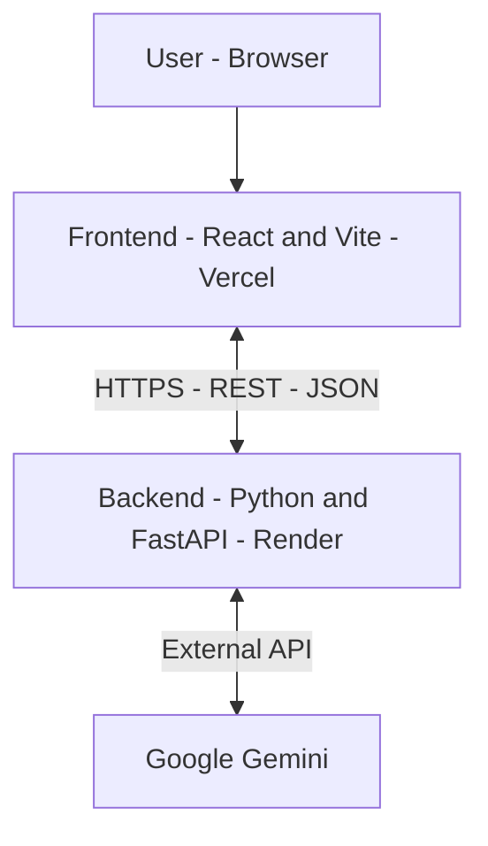

**English** | [Español](README.es.md)

# 🍕 Fornaviva

## Project description

Fornaviva is a full-stack web application simulating the digital platform of a fictional Italian pizzeria. Users can browse the menu, opening hours, allergen information and frequently asked questions. An AI-powered conversational assistant answers queries and manages simulated reservations.

The project combines a React and Vite frontend, a Python and FastAPI REST API, and Google Gemini integration.

**Status:** completed, deployed and published.

**Official version:** `v1.0.0`.

## Project objective

Fornaviva is a personal learning and professional portfolio project applying software development knowledge through a complete web application. It covers the software lifecycle: design, implementation, external service integration, automated testing, accessibility, security, performance, documentation and deployment.

## Live demo

- **Web application:** https://fornaviva.vercel.app
- **REST API:** https://fornaviva-api.onrender.com

The web application is publicly accessible without registration, installation or credential configuration. Simply open the live demo to use the Google Gemini assistant. Integration is configured on the Render backend and subject to service availability and usage limits.

The interface and assistant are available in Spanish. The restaurant is fictional and reservations have no commercial validity.

## Technologies

| Technology | Responsibility |
|---|---|
| React | User interface development |
| Vite | Frontend development and build environment |
| Python | Backend programming language |
| FastAPI | REST API development |
| Pydantic | Data validation |
| Google Gemini | Conversational AI |
| Pytest | Backend automated testing |
| Vitest | Frontend automated testing |
| Oxlint | Frontend static analysis |
| Vercel | Frontend hosting and deployment |
| Render | Backend hosting and deployment |
| Git and GitHub | Version control and repository management |

## System architecture

Fornaviva uses a client-server architecture with separate frontend and backend. The frontend communicates with the REST API through HTTP requests using JSON. The backend centralizes application logic, data validation and Google Gemini communication. AI integration occurs exclusively on the server, keeping credentials out of the client.



## Project structure

```text
Fornaviva/
├── backend/
│   ├── chatbot/
│   ├── data/
│   ├── routes/
│   ├── tests/
│   ├── main.py
│   ├── request_limits.py
│   └── requirements.txt
├── frontend/
│   ├── src/
│   │   ├── data/
│   │   ├── App.jsx
│   │   ├── ChatWidget.jsx
│   │   ├── OvenWait.jsx
│   │   ├── serviceState.js
│   │   └── useServices.js
│   ├── tests/
│   ├── package.json
│   ├── package-lock.json
│   └── vite.config.js
├── .gitignore
├── LICENSE
├── README.md
└── README.es.md
```

Restaurant data is stored in four backend JSON files. The frontend includes a local menu copy and culinary facts for the assistant's waiting experience. No database is used for simulated reservations.

## Features

### Restaurant menu

- Browse pizzas, antipasti, dolci and drinks with category filters.
- Display names, descriptions and prices; ingredients can be queried through the assistant when documented.
- Immediate availability through a local menu copy.
- Silent REST API synchronization; on failure, retain the available menu and offer a retry.

### Opening hours

- Consult opening hours through the assistant and corresponding endpoint.

### Allergen information

- Consult information through the assistant and API. Information is indicative and does not guarantee absence of traces.

### Frequently asked questions

- Access common restaurant information through the assistant and API.

### AI conversational assistant

- Google Gemini integration.
- Natural-language interaction and contextualized answers about Fornaviva.
- Conversation history without permanent server-side memory.
- Queries about menu, opening hours, allergens and services.
- Conversational management of simulated reservations.

### Simulated reservation system

- Collect reservation details through the assistant.
- Manage reservation state during conversation.
- Simulate reservations without persistent storage or real commercial effects. Python validates and confirms simulations; Gemini does not directly confirm reservations.

### User experience

- Responsive web interface.
- Adaptive floating panel up to 420 × 600 px, allowing continued browsing during conversation.
- Initial greeting visible only when the backend responds.
- Themed waiting experience with animated oven and culinary facts during prolonged connection.
- Message processing indicator, error handling, accessibility and usability measures.

### Online availability

- Frontend deployed on Vercel.
- Backend deployed on Render.
- HTTPS client-server communication.

## Development phases

Fornaviva development was organized into eight phases covering the software lifecycle.

### Phase 1 — Project foundation

**Status: completed.**

- Define objectives and scope.
- Select technologies.
- Create frontend and backend structure.
- Configure the development environment.
- Establish client-server communication.

### Phase 2 — Feature development

**Status: completed.**

- Implement pizza menu.
- Provide opening hours, allergen information and FAQs.
- Develop REST API endpoints.
- Implement simulated reservation logic.

### Phase 3 — AI integration

**Status: completed.**

- Integrate Google Gemini with FastAPI.
- Develop conversational assistant.
- Contextualize responses.
- Manage conversation history without permanent server memory.
- Manage simulated reservations conversationally.

### Phase 4 — Automated testing

**Status: completed.**

- Develop backend tests with Pytest and frontend tests with Vitest.
- Verify application behaviour.
- Historical record of 211 passing tests: 199 backend and 12 frontend, before final refinements.

### Phase 5 — Accessibility and usability

**Status: completed.**

- Evaluate user experience.
- Audit with Lighthouse, WAVE and axe.
- Correct detected accessibility issues.
- Evaluate overall interface quality.

Historical Lighthouse results:

| Category | Score |
|---|---:|
| Performance | 88/100 |
| Accessibility | 96/100 |
| Best practices | 100/100 |
| SEO | 90/100 |

The last axe check detected no issues.

### Phase 6 — Security and performance

**Status: completed.**

- Protect external service credentials.
- Configure CORS.
- Validate data with Pydantic.
- Limit AI service usage.
- Control timeouts and request sizes.
- Manually verify endpoints using Postman.
- Evaluate response times.
- Identify probable backend cold starts as a deployment limitation.

### Phase 7 — Documentation

**Status: completed.**

- Prepare README.
- Document technologies and architecture.
- Describe features and REST API.
- Provide local installation and execution instructions.
- Record tests, security measures and performance results.

### Phase 8 — Final improvements, publication and portfolio

**Status: completed.**

- Implement immediate menu, silent synchronization and themed assistant waiting experience.
- Refine chatbot dimensions, greeting and oven animation.
- Complete development and deploy final version.
- Publish source code in a public GitHub repository.
- Publish release `v1.0.0` and include it in the professional portfolio.

## REST API documentation

The Python and FastAPI REST API provides restaurant data and centralizes communication with the AI assistant.

### Base URL

https://fornaviva-api.onrender.com

### Available endpoints

| Method | Endpoint | Description |
|---|---|---|
| GET | `/api/menu` | Retrieve complete menu |
| GET | `/api/horarios` | Retrieve opening hours |
| GET | `/api/alergenos` | Retrieve allergen information |
| GET | `/api/faqs` | Retrieve frequently asked questions |
| POST | `/api/chat` | Process messages using optional Gemini or deterministic logic |

### HTTP request examples

#### 1. Retrieve the pizza menu

```bash
curl -X GET https://fornaviva-api.onrender.com/api/menu
```

Returns the complete restaurant menu.

#### 2. Retrieve opening hours

```bash
curl -X GET https://fornaviva-api.onrender.com/api/horarios
```

Returns restaurant opening hours.

#### 3. Retrieve allergens

```bash
curl -X GET https://fornaviva-api.onrender.com/api/alergenos
```

Returns allergen information.

#### 4. Retrieve FAQs

```bash
curl -X GET https://fornaviva-api.onrender.com/api/faqs
```

Returns frequently asked questions and answers.

#### 5. Send a message to the assistant

Method: `POST`. Content-Type: `application/json`.

```bash
curl -X POST https://fornaviva-api.onrender.com/api/chat \
  -H "Content-Type: application/json" \
  -d '{
    "mensaje": "¿Qué pizzas tenéis?",
    "historial": [],
    "estado_reserva": null
  }'
```

JSON request body:

```json
{
  "mensaje": "¿Qué pizzas tenéis?",
  "historial": [],
  "estado_reserva": null
}
```

| Field | Description |
|---|---|
| `mensaje` | User message to the assistant |
| `historial` | Conversation history |
| `estado_reserva` | Simulated reservation state; may be null |

The backend returns a JSON object with `respuesta` (text) and `estado_reserva` (object or null). Python handles reservations. Deterministic responses are used if Gemini is disabled or unavailable; a specific notice is returned when the local budget is exhausted.

### Request verification

All five endpoints were checked using Postman during the security and performance phase, returning HTTP `200 OK`. Validation checks included `422` for a missing required `mensaje` field and `405` for `DELETE /api/menu`. The curl examples use Bash-compatible syntax.

### Response time considerations

The first request after inactivity may be delayed by a Render backend cold start. Subsequent requests are faster once the service starts.

### Conversational assistant

`POST /api/chat` receives user messages, conversation history and reservation state. Google Gemini communication takes place on the backend. Requests use JSON.

### HTTP status codes

| Code | Status | Description |
|---|---|---|
| 200 | OK | Request processed successfully |
| 405 | Method Not Allowed | HTTP method not permitted |
| 422 | Unprocessable Entity | Input validation error |
| 413 | Content Too Large | POST body exceeds 128 KiB |
| 503 | Service Unavailable | Data file could not be loaded |

Codes 200, 405 and 422 were checked with Postman; 413 and 503 are defined in the code.

### Interactive documentation

- [Swagger UI](https://fornaviva-api.onrender.com/docs)
- [ReDoc](https://fornaviva-api.onrender.com/redoc)
- [OpenAPI JSON](https://fornaviva-api.onrender.com/openapi.json)

FastAPI generates these default documentation routes. In addition to the five functional endpoints, `GET /` returns basic project information.

## Local installation and execution

Local execution is documented as a technical reference using the deterministic backend without Gemini. For the complete AI experience, open the live demo.

### Prerequisites

- Python 3.14.7 (recorded development version; no unverified minimum is specified).
- Node.js 22.22.2 or later within the 22 branch, or 24.15.0 or later within the 24 branch (compatible with Vite, Vitest and jsdom according to the lockfile).
- npm and Git.

### 1. Obtain the project

Clone the Fornaviva repository from GitHub and enter its root directory.

### 2. Backend setup

```bash
cd backend
python -m venv .venv
```

Activate on Windows (PowerShell):

```powershell
.\.venv\Scripts\Activate.ps1
```

On Linux or macOS:

```bash
source .venv/bin/activate
```

Install dependencies:

```bash
python -m pip install -r requirements.txt
```

### 3. Local backend configuration

Deterministic mode works with default configuration unless overridden by environment variables. The public demo's Gemini integration is managed on the Render backend.

### 4. Run the backend

From `backend`:

```bash
python -m uvicorn main:app --reload --port 8000
```

Server: http://localhost:8000. Interactive API documentation: http://localhost:8000/docs and http://localhost:8000/redoc. `--reload` automatically restarts the server on development code changes.

### 5. Frontend setup

Open a second terminal from the project root:

```bash
cd frontend
npm ci
```

This requires `package-lock.json`; if unavailable, use `npm install`.

### 6. Frontend environment variables

Optionally create `frontend/.env`:

```env
VITE_API_URL=http://localhost:8000
```

This sets the backend address. If omitted, the default is `http://localhost:8000`.

### 7. Run the frontend

```bash
npm run dev -- --port 5173
```

Open http://localhost:5173. Both servers must remain running for local execution.

### 8. Production build

```bash
npm run build
npm run preview
```

The first command creates an optimized production build; the second previews it locally.

### 9. Automated tests

From `backend`, with the virtual environment activated:

```bash
python -m pytest tests -q -o asyncio_default_fixture_loop_scope=function
```

Tests isolate dotenv and simulate Gemini calls; no real key is required. From `frontend`:

```bash
npm test
```

### 10. Frontend static analysis

```bash
npm run lint
```

Runs Oxlint static analysis.

## Testing and software quality

Automated tests and manual checks evaluate application behaviour, stability and quality.

### Automated tests

| Component | Tool | Passing tests |
|---|---|---:|
| Backend | Pytest | 199 |
| Frontend | Vitest | 12 |
| **Total** | | **211** |

The recorded development run passed 211 tests before final refinements. These figures do not represent code coverage or certify the final version. The frontend suite currently declares 20 test cases. One assertion in `frontend/tests/App.test.jsx` corresponds to the previous menu synchronization notice behaviour. No complete suite execution result is available after the final refinements.

### Manual REST API tests

Postman integrated into Visual Studio Code was used to check the Render API.

| Method | Endpoint | Result |
|---|---|---|
| GET | `/api/menu` | 200 OK |
| GET | `/api/horarios` | 200 OK |
| GET | `/api/alergenos` | 200 OK |
| GET | `/api/faqs` | 200 OK |
| POST | `/api/chat` | 200 OK |

| Error test | Result |
|---|---|
| Chat request missing `mensaje` | 422 |
| DELETE request to `/api/menu` | 405 |

These results verify endpoint behaviour for the evaluated requests and error conditions.

## Accessibility and usability

Google Lighthouse, WAVE and axe DevTools were used during development to identify improvements in accessibility, usability and interface quality.

### Historical Lighthouse results

| Category | Score |
|---|---:|
| Performance | 88/100 |
| Accessibility | 96/100 |
| Best practices | 100/100 |
| SEO | 90/100 |

### axe DevTools results

The last axe DevTools check detected zero issues. These development audits do not constitute full accessibility certification.

## Security

Security measures are adapted to the application's demonstration scope.

### Credential protection

The Google Gemini key is stored in server environment variables. In production, `LLM_API_KEY` is configured directly in Render. Visitors do not need to know it or configure their own credentials. Gemini communication occurs on the backend, avoiding frontend key exposure.

### CORS configuration

The backend restricts permitted browser request origins. In production, the authorized origin is the Vercel frontend. CORS is not authentication and does not prevent direct access to public endpoints through HTTP clients.

### Data validation

FastAPI and Pydantic validate API input before processing. Requests that do not meet schema requirements produce validation errors.

### Resource limits

| Measure | Configured value |
|---|---|
| AI attempts per minute | 10 |
| AI attempts per rolling 24 hours | 100 |
| AI integration timeout | 12 seconds |
| Maximum POST request body | 128 KiB |

AI limits are maintained in memory and apply globally within each backend process. Failed attempts consume budget. Counters reset with the process and are not shared across workers. They do not replace provider quotas.

### Optional Gemini integration and privacy

The backend uses `google-genai==2.34.0` and the model configured through `LLM_MODEL_NAME` (project reference: `gemini-3.5-flash-lite`). Model availability depends on the provider. Restaurant data and up to six previous messages plus the current question are sent subject to filters. Filters and model instructions reduce risks but cannot guarantee detection of all personal data or response accuracy. Do not enter real personal data in this demonstration.

### Secure communication

Vercel and Render deployments use HTTPS in production.

## Performance

Manual testing recorded the following deployed API response times:

| Operation | Observed time |
|---|---:|
| First menu GET after inactivity | 42.89 seconds |
| Subsequent menu GET | 265 milliseconds |
| Chatbot POST | 8.14 seconds |

These are individual Postman measurements, not averages or performance guarantees.

### Backend cold start

The backend uses Render's free service. After inactivity, the service may be suspended temporarily; a new request can require reactivation, increasing initial latency. This is known as a cold start. Subsequent requests may be considerably faster.

An additional web application check after approximately twelve hours of inactivity observed an estimated ten-second wait for the menu. This measurement concerns an earlier version. The current menu appears immediately from a local copy and synchronizes silently during normal loading. The chatbot reports availability independently.

### Assistant performance

Chatbot response time depends on backend availability, network latency, Google Gemini availability and model processing time. The interface displays a waiting indicator during message processing.

### Availability during cold starts

The menu is displayed from `frontend/src/data/menu.json` and updated through `/api/menu`. On failure, the available copy is retained with a notice and retry option. Changes to `backend/data/menu.json` must also update the frontend copy; a content equality test exists.

The assistant checks `GET /`, not Gemini availability. While connecting, message submission is disabled and the greeting hidden. After three seconds, an oven with continuous animation (disabled for reduced motion) and 20 local culinary facts with source links and pause control appear. Facts rotate every eight seconds. When the backend responds, the waiting display disappears and the greeting appears. Menu and chatbot retries are independent, and each availability request has a 90-second limit. No additional Gemini calls occur during waiting.

## Known limitations

- Free backend hosting may cause cold starts.
- Generative responses depend on Gemini; deterministic mode and simulated reservations do not.
- AI service consumption is subject to usage limits.
- In-memory limits do not persist across server restarts.
- The REST API is public and does not require authentication.
- Reservations are simulated and have no commercial validity.

These limitations are acceptable within Fornaviva's current learning and portfolio scope.

## Publication and portfolio

Fornaviva has completed all eight development phases and is presented as a finished full-stack AI software project in its author's technical portfolio. Official version `v1.0.0` is published on GitHub. Source code is available in this public repository; the application and REST API are deployed on Vercel and Render respectively.

- [Web application](https://fornaviva.vercel.app)
- [REST API](https://fornaviva-api.onrender.com)
- [Developer's GitHub profile](https://github.com/MRTN0624)

## License and copyright

Copyright © 2026 MRTN0624 — Fornaviva. All rights reserved.

Source code is published for demonstration, educational and professional portfolio purposes. Access to and use of the deployed web application are permitted. Publication does not grant permission to reuse, modify, distribute or commercialize original code without the author's prior express permission, except for rights recognized by applicable law and GitHub's terms.

Third-party components and resources retain their respective licenses. See [LICENSE](LICENSE) for details.

## Additional technical documentation

- [Gemini integration](backend/GEMINI.md).
- [Backend stabilization (historical record)](backend/ESTABILIZACION.md).
- [Test corrections (historical record)](backend/CAMBIOS_TESTS.md).
